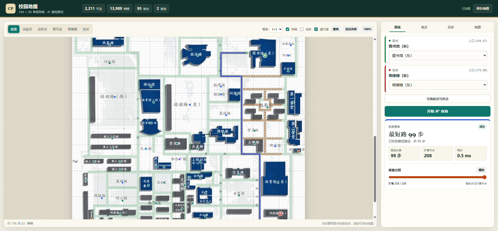

# CampusPath 校园地图与最短路径查询

Python 课程综合实验题目 9。基于一张 180×90 的校园网格图，提供建筑点位、地图编辑、SQLite 保存、地点检索、A* 最短路径、搜索过程展示和历史路线查看。



## 快速启动

只需要 Python 3.10 或更高版本，运行时全部使用标准库，不需要安装第三方包。

```powershell
cd C:\Users\lmy21\Documents\ChatGPT\Python实验
python app.py
```

浏览器会自动打开 `http://127.0.0.1:8000/`。如果端口被占用：

```powershell
python app.py --port 8080
```

也可以双击 `start.bat`。首次运行会自动创建 `data/campuspath.db`，并写入 180×90 基准地图和 95 个地点。

## 功能对照题目要求

| 题目要求 | 实现 |
| --- | --- |
| 图形展示网格地图、建筑入口和障碍物 | Canvas 绘制底图、180×90 网格、95 个地点圆点；建筑圆点落在建筑本体，入口落在最近的主路网可走格 |
| 选择起终点 | 地图点选、地点列表按钮、下拉框三种方式 |
| 编辑可通行区域 | “画可走 / 画障碍”笔刷，支持 1×1、3×3、5×5 和拖动连续涂格 |
| 保存和加载地图 | 每次编辑自动写入 SQLite；支持手动保存、恢复基准图、导出/导入 JSON |
| 保存地点和查询记录 | `places`、`queries` 两张表；历史记录保留当时的地图快照 |
| 地点检索 | 按名称或别名过滤地点 |
| 地图维护 | 新增、编辑、删除地点；查看可走格、障碍格和连通块 |
| 历史路线查看 | 查看历史路径、步数、扩展节点数；可载入当时地图快照复现 |
| A* 搜索 | 四方向、单位步长、曼哈顿距离；显示路径长度、扩展节点数和搜索动画 |
| 终点不可达 | 明确显示“终点不可达”并保留已扩展节点，方便检查障碍物 |

## 地图数据

- 地图尺寸：180 行 × 90 列，共 16,200 格。
- 数据约定：`0 = 可走`，`1 = 不可走`。
- 可走格：2,211 个；障碍格：13,989 个。
- 地点：95 个，覆盖 PDF 中可识别的建筑、宿舍、食堂、场馆、运动场、园区和校门。
- 每个地点都有“标记坐标”和“入口坐标”。建筑圆点画在建筑本体上，入口吸附到最近的主连通路网；选中起终点时会用虚线连出标记到入口，路线从入口格开始计算。
- 手绘地图不包含天桥二层结构；天桥不参与寻路。
- 未涂色区域按不可走处理，不会默认可通行。
- 网格与底图按建筑轮廓做过对齐校准（整体下移 8 格），绿色可走格与底图道路重合。

数据文件：

- `data/base_map.json`：基准 0/1 网格。
- `data/places.json`：95 个地点及入口坐标。
- `static/campus_map.jpg`：从原始 PDF 渲染并裁切的底图。

## A* 算法

`campus/astar.py` 中的 `AStarFinder`：

- 只允许上、下、左、右移动。
- 每步代价为 1。
- 启发函数为曼哈顿距离：`|r1-r2| + |c1-c2|`。
- 用 `g` 记录起点到当前点的实际代价，用 `f = g + h` 排序。
- 返回 `path`、`cost`、`expanded`、`expanded_order` 和 `found`。
- `expanded_order` 按节点弹出顺序保存，前端据此播放搜索过程。
- 不可达时返回已经扩展的节点，不会只给一句“失败”。

## 面向对象结构

| 类 | 文件 | 职责 |
| --- | --- | --- |
| `CampusMap` | `campus/map.py` | 网格、边界、邻居、编辑、快照、连通块、最近可走格 |
| `Node` | `campus/astar.py` | A* 节点，保存 `g/h/parent`，按 `f` 排序 |
| `Place` | `campus/models.py` | 地点数据对象，区分标记位置和入口位置 |
| `PathResult` | `campus/models.py` | 路径、代价、扩展节点、搜索顺序、耗时 |
| `AStarFinder` | `campus/astar.py` | 四方向 A* 搜索和路径回溯 |
| `MapService` | `campus/database.py` | 地图、地点、查询记录的 SQLite 持久化 |
| `CampusApplication` | `app.py` | HTTP API 和业务编排 |

## SQLite 表

`data/campuspath.db` 首次启动自动创建：

- `maps`：地图名称、行列数、0/1 网格 JSON、更新时间。
- `cells`：16,200 行网格镜像（`map_id, row, col, blocked`），方便直接用 SQL 查询障碍物。
- `places`：地点名称、类型、标记坐标、入口坐标、别名。
- `queries`：起点/终点、路径 JSON、步数、扩展节点数、耗时、地图快照和快照指纹。

查询记录最多保留最近 100 条。数据库文件不提交到 Git。

## HTTP API

| 方法 | 路径 | 用途 |
| --- | --- | --- |
| GET | `/api/state` | 地图、地点、统计和历史 |
| POST | `/api/route` | A* 查询 |
| POST | `/api/edit` | 批量修改网格并保存 |
| POST | `/api/map/save` | 显式保存 |
| POST | `/api/map/reset` | 恢复基准地图 |
| POST | `/api/map/snapshot` | 载入历史地图快照 |
| GET | `/api/map/export` | 导出地图和地点 JSON |
| POST | `/api/map/import` | 导入地图和地点 JSON |
| POST | `/api/places` | 新增、修改、删除地点 |
| GET | `/api/history` | 查询记录列表 |
| GET | `/api/history/<id>` | 单条记录详情 |

## 测试

```powershell
python -m unittest discover -s tests -p "test_*.py" -v
```

测试覆盖：

- 0/1 语义、编辑、快照、最近可走格、连通块。
- 最短路、绕墙、不可达、起点/终点在障碍物、起终点相同。
- SQLite 初始数据、地点增删改、地图保存/恢复、历史记录、导入导出。
- HTTP 状态、路线查询、地图编辑、导出和错误请求。

## 目录

```text
app.py                  HTTP 服务器和 API
campus/                 地图、A*、SQLite、数据对象
data/                   基准网格和地点数据
static/                 Canvas 前端、样式、底图
tests/                  unittest
tools/build_data.py     一次性地图数据生成脚本
docs/screenshot.png     界面截图
```

## 已知限制

- 地图来自课程 PDF 和手绘上色结果，建筑入口是“最近的可走格”近似值，不是实测门位置。
- 当前只支持单层 180×90 地图，不含天桥二层。
- 路线只用于课程演示，不能作为实际校园导航依据。
